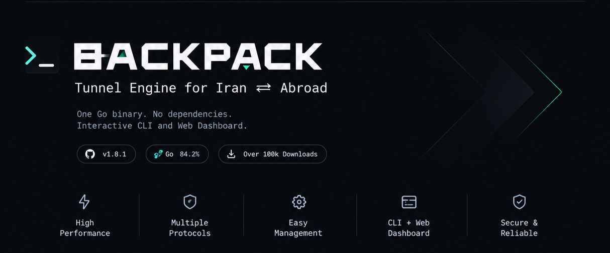

<p align="center">
  
</p>

<h1 align="center">BackPack</h1>

<p align="center">
  <b>High-performance tunneling between Iran and abroad — built in Go.</b>
</p>

<p align="center">
  <a href="https://github.com/AminMGMT/BackPack/releases/latest">
    
  </a>
  <a href="go.mod">
    
  </a>
  <a href="LICENSE">
    
  </a>
  <a href="https://github.com/AminMGMT/BackPack/stargazers">
    
  </a>
  <a href="https://github.com/AminMGMT/BackPack/releases">
    
  </a>
</p>

<p align="center">
  <a href="tutorial/README.md">Tutorials</a> ·
  <a href="docs/README.md">Documentation</a> ·
  <a href="README_FA.md">فارسی</a> ·
  <a href="README_RU.md">Русский</a> ·
  <a href="https://t.me/BlackProtocols">Telegram</a> ·
  <a href="https://t.me/BlackProtocolsGroup">Community</a>
</p>

---

# Quick Start

## 1. Install

On both servers:

```bash
bash <(curl -fsSL https://raw.githubusercontent.com/AminMGMT/BackPack/main/install.sh)
```

Then:

```bash
sudo backpack
```

The installer downloads the release for the server architecture, verifies its published checksum, installs it and opens the CLI.

Supported release architectures currently include:

```text
x86_64  → amd64
aarch64 → arm64
```

If the server cannot reach GitHub, BackPack also supports a completely offline installation.

See [Installation](docs/install.md).

---

## 2. Configure the Iran server

```bash
sudo backpack
```

Then:

```text
1. Setup Iran
→ Reverse
→ Transport
→ Iran IP Or Domain (the detected one is the default)
→ Tunnel Port
→ Forwarded Ports
→ Tunnel Name
→ Security Token (generated — press Enter)
→ Carry UDP As Well As TCP
→ the transport's own questions (certificate for WSS, flags for PCK, …)
→ How Should The Tunnel Be Tuned?
```

The summary before **Create This Tunnel** shows a one-line **Setup Link** (`backpack://…`). Copy it.

For a first deployment, **TCP** is the simplest starting point.

---

## 3. Configure the kharej server

```bash
sudo backpack
```

Then:

```text
2. Setup Kharej
→ Reverse
→ Same transport
→ Setup Link → paste the link → Tunnel Name → Create This Tunnel
```

**Manual** is there too: Iran IP, the same tunnel port, a name, the same token, the same preset.

---

## 4. Check the tunnel

Use:

```text
Manage → Status
```

Then:

```text
Manage → Health Check
```

If you are unsure which transport to use:

```text
Manage → Link Test
```

Link Test measures the route over TCP, including latency, jitter and packet loss, and recommends a suitable transport.

See [Choosing a transport](docs/choosing-a-transport.md).

---

# Documentation

BackPack intentionally separates **setup tutorials** from **technical reference**.

## Tutorials

The `tutorial/` directory explains how to actually build a tunnel, step by step, following the CLI wizard.

### Start here

* [Before you start](tutorial/before-you-start.md)

### Reverse transports

* [TCP](tutorial/tcp.md)
* [TCP Mux](tutorial/tcp-mux.md)
* [TCP + Stealth](tutorial/tcp-stealth.md)
* [TCP + PCK](tutorial/tcp-pck.md)
* [UDP](tutorial/udp.md)
* [UDP + KCP + FEC](tutorial/udp-kcp-fec.md)
* [UDP + QUIC](tutorial/udp-quic.md)
* [WS / WS Mux](tutorial/websocket.md)
* [WSS / WSS Mux](tutorial/websocket-tls.md)
* [xDi / ICMP](tutorial/xdi-icmp.md)

### Special deployments

* [Forwarded UDP](tutorial/udp-forwarding.md)
* [Behind X-UI / 3x-ui / Marzban](tutorial/behind-a-panel.md)
* [Direct tunnel](tutorial/direct-tunnel.md)
* [IP Spoofing](tutorial/ip-spoofing.md)

---

## Documentation reference

### Architecture & internals

* [Architecture](docs/architecture.md)
* [Design decisions](docs/design-decisions.md)
* [Performance notes](docs/performance-notes.md)
* [Configuration reference](docs/config-reference.md)

### Transports & networking

* [Transports](docs/transports.md)
* [Choosing a transport](docs/choosing-a-transport.md)
* [Transport fallback](docs/transport-fallback.md)
* [Direct layer-3 tunnel](docs/l3-direct-tunnel.md)
* [Direct stream tunnel — removed in v2.0.0](docs/direct-tunnel.md)
* [TCP + PCK](docs/tcp-pck.md)
* [IP Spoofing](docs/ip-spoofing.md)
* [Port mappings](docs/port-mappings.md)
* [Forwarded UDP](docs/forwarded-udp.md)
* [TCP MSS clamp](docs/mss-clamp.md)
* [Filtered / dirty IP](docs/filtered-or-dirty-ip.md)
* [WSS camouflage](docs/camouflage.md)

### Operations

* [Installation](docs/install.md)
* [CLI menu](docs/cli-menu.md)
* [Server layout](docs/server-layout.md)
* [Web Panel](docs/web-panel.md)
* [Web Panel screens](docs/web-panel-screens.md)
* [Managed servers](docs/managed-servers.md)
* [Health Check](docs/health-check.md)
* [Tunnel Metrics](docs/tunnel-metrics.md)
* [Monitor service](docs/monitor-service.md)
* [Troubleshooting](docs/troubleshooting.md)

### Reliability & maintenance

* [Failover & load balancing](docs/failover-load-balancing.md)
* [Transport fallback](docs/transport-fallback.md)
* [Backup & Restore](docs/backup-restore.md)
* [Updates & rollback](docs/updates.md)
* [Performance presets](docs/performance-presets.md)
* [Per-tunnel limits](docs/limits.md)
* [Real client IP](docs/real-client-ip.md)

### Management & security

* [Access control](docs/access-control.md)
* [Telegram bot](docs/telegram-bot.md)
* [Alerts](docs/alerts.md)
* [Log schema](docs/log-schema.md)

### Development

* [Contributing](CONTRIBUTING.md)
* [Releasing](docs/releasing.md)

> Every documentation page includes a Persian summary where applicable.

---

# License

Copyright © 2026 Amin Mohammadi (AminMGMT).

BackPack is released under the **GNU Affero General Public License v3.0 (AGPL-3.0)**.

See:

* [LICENSE](LICENSE)
* [NOTICE](NOTICE)
* [TRADEMARK.md](TRADEMARK.md)

You may use, study, modify, redistribute and build a business on BackPack under the terms of the license.

Additional attribution and trademark conditions apply.

### Attribution

Modified versions must keep this line, unaltered, in their README (and in NOTICE):

```text
Based on BackPack by Amin Mohammadi (AminMGMT)
https://github.com/AminMGMT/BackPack
```

### Name & logo

**BackPack**, its name and logo are not licensed as part of the source code.

Forks should use their own name and branding.

It is permitted to truthfully state that a project is based on or compatible with BackPack.

See [TRADEMARK.md](TRADEMARK.md) for the complete terms.
