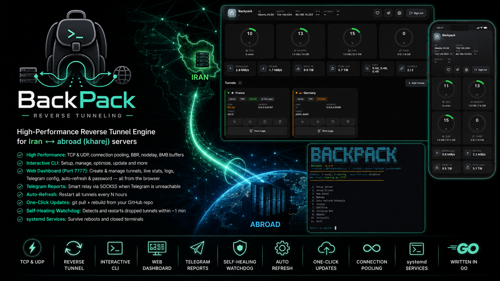

<div dir="rtl">

<p align="center"></p>

# بک‌پک 🎒

<p align="center">
  <a href="go.mod"></a>
  <a href="https://github.com/AminMGMT/BackPack/releases/latest"></a>
  <a href="LICENSE"></a>
  <a href="https://github.com/AminMGMT/BackPack/stargazers"></a>
  <a href="https://github.com/AminMGMT/BackPack/releases"></a>
</p>

**بک‌پک** یک هستهٔ تونل با کارایی بالاست که کاملاً با **Go** نوشته شده و برای
ست‌آپ سرور ایران ⇄ خارج طراحی شده. یک باینری واحد است با یک منوی تعاملی CLI
**و** یک پنل وب امن — یعنی همه‌چیز را با ترمینال یا بدون ترمینال می‌توانی
مدیریت کنی.

تونل را به دو شکل می‌برد: **معکوس** (خارج به ایران وصل می‌شود) و **مستقیم**
(ایران به خارج وصل می‌شود و یک تونل کامل IP می‌سازد؛ حامل‌هایش xDi، PCK،
IP Spoofing، SNI Spoofing و GRE هستند).

</div>

<p align="center">
  <b><a href="tutorial/README.md">📘 آموزش‌های راه‌اندازی</a></b> ·
  <b><a href="docs/README.md">📚 مستندات</a></b> ·
  <b><a href="README.md">🇬🇧 English</a></b> ·
  <b><a href="README_RU.md">🇷🇺 Русский</a></b> ·
  <b><a href="https://t.me/BlackProtocols">✈️ تلگرام</a></b>
</p>

<div dir="rtl">

> هر صفحهٔ `docs/` و `tutorial/` در انتها یک **خلاصهٔ فارسی** دارد.

---

## نصب

فقط یک دستور با کاربر root روی VPS. آرشیو ریلیز مخصوص معماری سرورت را دانلود
می‌کند، **با چک‌سام منتشرشده تأیید می‌کند**، نصب می‌کند و خودش منو را باز می‌کند:

</div>

```bash
bash <(curl -fsSL https://raw.githubusercontent.com/AminMGMT/BackPack/main/install.sh)
```

<div dir="rtl">

دفعات بعد هر وقت خواستی با `sudo backpack` بازش کن.

> **سرور به اینترنت دسترسی ندارد؟** یک مسیر نصب آفلاین کامل وجود دارد — فقط یک
> آرشیو را کپی کن. build از سورس هم به‌عنوان راه دوم کار می‌کند.
> **← [راهنمای کامل نصب](docs/install.md)**

---

## شروع سریع

**اول نقش‌ها را درست بگیر** — تنها جایی که همه اشتباه می‌کنند همین است:

| سرور | نقش | گزینهٔ منو | چرا |
|------|-----|------------|-----|
| **ایران** | ورودی | **۱. Setup Iran** | پورت‌ها را باز می‌کند؛ کاربر به **آی‌پی ایران** وصل می‌شود. |
| **خارج** | خروجی | **۲. Setup Kharej** | به سرور ایران وصل می‌شود و ترافیک را به سرویس واقعی می‌رساند. |

**همیشه اول سرور ایران را بساز** — کلاینت به آدرس ایران و توکنی که سرور می‌سازد
نیاز دارد.

</div>

```bash
# روی سرور ایران
sudo backpack   →  1. Setup Iran
#   Reverse → ترنسپورت → آی‌پی/دامنهٔ ایران → پورت تونل → پورت‌های forward
#   → نام → توکن (Enter) → سؤال UDP → پریست (Turbo) → Setup Link را کپی کن

# روی سرور خارج
sudo backpack   →  2. Setup Kharej
#   Reverse → همان ترنسپورت → Setup Link → لینک را پیست کن → نام → تمام
#   (یا Manual: آی‌پی ایران + همان پورت تونل → نام → همان توکن → همان پریست)
```

<div dir="rtl">

بعد با `Manage → Status` هر دو طرف را ببین، و اگر چیزی درست نبود
`Manage → Health Check` زیر هر مشکل راه‌حلش را می‌نویسد.

**← [قبل از شروع](tutorial/before-you-start.md)** نقش‌ها، توکن، نگاشت پورت‌ها و
فایروال را کامل توضیح می‌دهد. بعد از آن، هر ترنسپورت صفحهٔ قدم‌به‌قدم خودش را دارد.

> روی سرور خارج **X-UI، 3x-ui یا مرزبان** داری؟ رایج‌ترین حالت همین است و چهار
> نکتهٔ مخصوص خودش را دارد — **[← پشت یک پنل](tutorial/behind-a-panel.md)**.

---

## مستندات

**از اینجا شروع کن**

| | |
|---|---|
| **[📘 آموزش‌ها](tutorial/README.md)** | قدم‌به‌قدم، برای هر ترنسپورت یک صفحه — با تک‌تک سؤال‌های ویزارد و جوابشان |
| **[📚 فهرست مستندات](docs/README.md)** | مرجع: هر بخش چیست و چه تنظیماتی دارد |
| **[🚑 عیب‌یابی](docs/troubleshooting.md)** | به ترتیبِ اینکه هر علت چند وقت یک‌بار واقعاً جواب است |
| **[🖥 منوی CLI](docs/cli-menu.md)** | تک‌تک گزینه‌های همهٔ منوها، از جمله Fine Tune |

**تونل‌ها و ترنسپورت‌ها**

| | |
|---|---|
| [ترنسپورت‌ها](docs/transports.md) · [کدام را بردارم](docs/choosing-a-transport.md) | مقایسهٔ ترنسپورت‌ها، و چطور تصمیم بگیری |
| [تونل مستقیم](docs/l3-direct-tunnel.md) · [تونل لایه‌۴ (حذف‌شده)](docs/direct-tunnel.md) | تونل کامل IP با حامل‌های xDi، PCK، IP Spoofing، SNI Spoofing و GRE؛ و تونل قدیمی `[direct]` که در v2.0.0 حذف شد |
| [نگاشت پورت‌ها](docs/port-mappings.md) · [UDP روی تونل](docs/forwarded-udp.md) | هر شکلی که `ports = [...]` قبول می‌کند؛ و اگر UDP رد نشد |
| [fallback ترنسپورت](docs/transport-fallback.md) · [failover](docs/failover-load-balancing.md) | وقتی حامل بلاک است، و وقتی آدرس بلاک است |
| [استتار](docs/camouflage.md) · [IP Spoofing](docs/ip-spoofing.md) · [TCP + PCK](docs/tcp-pck.md) | سایت تقلبی، مبدأ جعلی، و TCP بدون کرنل |
| [MSS clamp](docs/mss-clamp.md) · [آی‌پی فیلتر یا کثیف](docs/filtered-or-dirty-ip.md) | راه‌حل «وصل است ولی چیزی رد نمی‌شود»، و آدرس بلاک‌شده |

**اجرا و نگه‌داری**

| | |
|---|---|
| [نصب](docs/install.md) · [آپدیت](docs/updates.md) · [بکاپ و ریستور](docs/backup-restore.md) | نصبش، به‌روز نگه‌داشتنش، و برگرداندنش |
| [پنل وب](docs/web-panel.md) · [صفحه‌به‌صفحه](docs/web-panel-screens.md) · [کنترل دسترسی](docs/access-control.md) | داشبورد، هر صفحه‌ای که دارد، و اینکه چه کسی چه کاری می‌تواند بکند |
| [سرورهای مدیریت‌شده](docs/managed-servers.md) · [سرویس مانیتور](docs/monitor-service.md) | ناوگان از یک صفحه، و سرویسی که مراقبش است |
| [ربات تلگرام](docs/telegram-bot.md) · [هشدارها](docs/alerts.md) · [Health Check](docs/health-check.md) | چه چیزی به تو می‌گوید، و کِی |
| [متریک تونل](docs/tunnel-metrics.md) · [فرستادن لاگ](docs/log-schema.md) · [آی‌پی واقعی کاربر](docs/real-client-ip.md) | چه چیزی را می‌سنجد، و چطور از سرور بیرونش بیاوری |
| [محدودیت‌ها](docs/limits.md) · [پریست‌ها](docs/performance-presets.md) · [چیدمان سرور](docs/server-layout.md) | سقف‌ها، تیونینگ، و اینکه هر چیزی روی دیسک کجاست |

**زیر کاپوت**

| | |
|---|---|
| [معماری](docs/architecture.md) · [مرجع کانفیگ](docs/config-reference.md) | از چه ساخته شده، و هر کلیدی که می‌خواند |
| [تصمیم‌های طراحی](docs/design-decisions.md) · [یادداشت‌های کارایی](docs/performance-notes.md) | چه کارهایی را عمداً نمی‌کند، و اندازه‌گیری‌هایی که تمامش کردند |
| [انتشار](docs/releasing.md) · [مشارکت](CONTRIBUTING.md) | چک‌لیست انتشار، و اینکه این کدبیس چطور نوشته می‌شود |

هر صفحه در انتها یک خلاصهٔ فارسی دارد.

---

## لایسنس

**کپی‌رایت © ۲۰۲۶ امین محمدی (AminMGMT).**
تحت **GNU Affero General Public License v3.0 (AGPL-3.0)** منتشر شده — فایل
[LICENSE](LICENSE) و [NOTICE](NOTICE).

می‌توانی از آن استفاده کنی، بخوانی‌اش، تغییرش بدهی، بازتوزیعش کنی و رویش
کسب‌وکار بسازی. دو شرط همراهش می‌آید که هر دو را بخش ۷ همان مجوز صریحاً اجازه
می‌دهد و هیچ‌کدام چیزی از آزادی‌هایی که می‌دهد کم نمی‌کند:

- **انتساب را نگه دار.** یک نسخهٔ تغییریافته باید این خط را بدون تغییر در README
  خودش (و در NOTICE) داشته باشد:

  ```text
  Based on BackPack by Amin Mohammadi (AminMGMT)
  https://github.com/AminMGMT/BackPack
  ```

- **از نام خودت استفاده کن.** «BackPack»، نام و لوگو همراه کد لایسنس نشده‌اند —
  یک fork به نام خودش نیاز دارد. گفتن این حقیقت که کارت بر پایهٔ BackPack است یا
  با آن سازگار است همیشه آزاد است. [TRADEMARK.md](TRADEMARK.md) را ببین.

</div>
