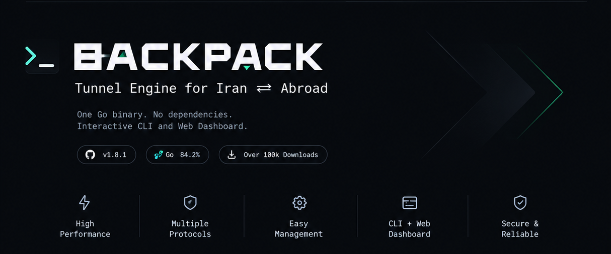

<p align="center">
  
</p>

<h1 align="center">BackPack</h1>

<p align="center">
  <b>Высокопроизводительные туннели между Ираном и зарубежьем — написано на Go.</b>
</p>

<p align="center">
  <a href="https://github.com/AminMGMT/BackPack/releases/latest">
    
  </a>
  <a href="go.mod">
    
  </a>
  <a href="LICENSE">
    
  </a>
  <a href="https://github.com/AminMGMT/BackPack/stargazers">
    
  </a>
  <a href="https://github.com/AminMGMT/BackPack/releases">
    
  </a>
</p>

<p align="center">
  <a href="tutorial/README.md">Руководства</a> ·
  <a href="docs/README.md">Документация</a> ·
  <a href="README.md">English</a> ·
  <a href="README_FA.md">فارسی</a> ·
  <a href="https://t.me/BlackProtocols">Telegram</a> ·
  <a href="https://t.me/BlackProtocolsGroup">Сообщество</a>
</p>

---

# Быстрый старт

## 1. Установка

На обоих серверах:

```bash
bash <(curl -fsSL https://raw.githubusercontent.com/AminMGMT/BackPack/main/install.sh)
```

Затем:

```bash
sudo backpack
```

Установщик скачивает релиз для архитектуры сервера, проверяет опубликованную контрольную сумму, устанавливает программу и открывает CLI.

Сейчас поддерживаются следующие архитектуры релизов:

```text
x86_64  → amd64
aarch64 → arm64
```

Если сервер не может подключиться к GitHub, BackPack поддерживает и полностью офлайн-установку.

Подробнее: [Installation](docs/install.md).

---

## 2. Настройка иранского сервера

```bash
sudo backpack
```

Затем:

```text
1. Setup Iran
→ Reverse
→ Transport
→ Iran IP Or Domain (по умолчанию подставляется определённый адрес)
→ Tunnel Port
→ Forwarded Ports
→ Tunnel Name
→ Security Token (генерируется — нажмите Enter)
→ Carry UDP As Well As TCP
→ собственные вопросы транспорта (сертификат для WSS, флаги для PCK, …)
→ How Should The Tunnel Be Tuned?
```

В сводке перед пунктом **Create This Tunnel** показана однострочная **Setup Link** (`backpack://…`). Скопируйте её.

Для первого развёртывания проще всего начать с **TCP**.

---

## 3. Настройка зарубежного (kharej) сервера

```bash
sudo backpack
```

Затем:

```text
2. Setup Kharej
→ Reverse
→ Same transport
→ Setup Link → paste the link → Tunnel Name → Create This Tunnel
```

Есть и вариант **Manual**: IP иранского сервера, тот же порт туннеля, имя, тот же токен и тот же пресет.

---

## 4. Проверка туннеля

Откройте:

```text
Manage → Status
```

Затем:

```text
Manage → Health Check
```

Если вы не уверены, какой транспорт выбрать:

```text
Manage → Link Test
```

Link Test измеряет маршрут по TCP, включая задержку, джиттер и потерю пакетов, и рекомендует подходящий транспорт.

Подробнее: [Choosing a transport](docs/choosing-a-transport.md).

---

# Документация

BackPack намеренно разделяет **руководства по настройке** и **техническую справку**.

> Подробная документация и руководства написаны на английском языке (в большинстве страниц есть краткое изложение на персидском). Ссылки ниже ведут на английские оригиналы.

## Руководства

В каталоге `tutorial/` пошагово описано, как построить туннель, следуя мастеру в CLI.

### Начните отсюда

* [Before you start](tutorial/before-you-start.md) — перед началом работы

### Reverse-транспорты

* [TCP](tutorial/tcp.md)
* [TCP Mux](tutorial/tcp-mux.md)
* [TCP + Stealth](tutorial/tcp-stealth.md) — TCP с маскировкой
* [TCP + PCK](tutorial/tcp-pck.md)
* [UDP](tutorial/udp.md)
* [UDP + KCP + FEC](tutorial/udp-kcp-fec.md)
* [UDP + QUIC](tutorial/udp-quic.md)
* [WS / WS Mux](tutorial/websocket.md)
* [WSS / WSS Mux](tutorial/websocket-tls.md)
* [xDi / ICMP](tutorial/xdi-icmp.md)

### Особые сценарии

* [Forwarded UDP](tutorial/udp-forwarding.md) — проброс UDP
* [Behind X-UI / 3x-ui / Marzban](tutorial/behind-a-panel.md) — за панелью X-UI / 3x-ui / Marzban
* [Direct tunnel](tutorial/direct-tunnel.md) — прямой туннель
* [IP Spoofing](tutorial/ip-spoofing.md) — подмена IP-адреса

---

## Справочная документация

### Архитектура и внутреннее устройство

* [Architecture](docs/architecture.md) — архитектура
* [Design decisions](docs/design-decisions.md) — проектные решения
* [Performance notes](docs/performance-notes.md) — заметки о производительности
* [Configuration reference](docs/config-reference.md) — справочник по конфигурации

### Транспорты и сеть

* [Transports](docs/transports.md) — транспорты
* [Choosing a transport](docs/choosing-a-transport.md) — как выбрать транспорт
* [Transport fallback](docs/transport-fallback.md) — резервный транспорт
* [Direct layer-3 tunnel](docs/l3-direct-tunnel.md) — прямой туннель третьего уровня
* [Direct stream tunnel — removed in v2.0.0](docs/direct-tunnel.md) — прямой потоковый туннель, удалён в v2.0.0
* [TCP + PCK](docs/tcp-pck.md)
* [IP Spoofing](docs/ip-spoofing.md)
* [Port mappings](docs/port-mappings.md) — сопоставление портов
* [Forwarded UDP](docs/forwarded-udp.md)
* [TCP MSS clamp](docs/mss-clamp.md)
* [Filtered / dirty IP](docs/filtered-or-dirty-ip.md) — заблокированный или «грязный» IP
* [WSS camouflage](docs/camouflage.md) — маскировка WSS

### Эксплуатация

* [Installation](docs/install.md) — установка
* [CLI menu](docs/cli-menu.md) — меню CLI
* [Server layout](docs/server-layout.md) — расположение файлов на сервере
* [Web Panel](docs/web-panel.md) — веб-панель
* [Web Panel screens](docs/web-panel-screens.md) — экраны веб-панели
* [Managed servers](docs/managed-servers.md) — управляемые серверы
* [Health Check](docs/health-check.md) — проверка состояния
* [Tunnel Metrics](docs/tunnel-metrics.md) — метрики туннеля
* [Monitor service](docs/monitor-service.md) — сервис мониторинга
* [Troubleshooting](docs/troubleshooting.md) — устранение неполадок

### Надёжность и обслуживание

* [Failover & load balancing](docs/failover-load-balancing.md) — отказоустойчивость и балансировка нагрузки
* [Transport fallback](docs/transport-fallback.md)
* [Backup & Restore](docs/backup-restore.md) — резервное копирование и восстановление
* [Updates & rollback](docs/updates.md) — обновления и откат
* [Performance presets](docs/performance-presets.md) — пресеты производительности
* [Per-tunnel limits](docs/limits.md) — лимиты для каждого туннеля
* [Real client IP](docs/real-client-ip.md) — реальный IP клиента

### Управление и безопасность

* [Access control](docs/access-control.md) — контроль доступа
* [Telegram bot](docs/telegram-bot.md) — Telegram-бот
* [Alerts](docs/alerts.md) — оповещения
* [Log schema](docs/log-schema.md) — схема логов

### Разработка

* [Contributing](CONTRIBUTING.md) — участие в разработке
* [Releasing](docs/releasing.md) — выпуск релизов

> Где это уместно, каждая страница документации содержит краткое изложение на персидском языке.

---

# Лицензия

Copyright © 2026 Amin Mohammadi (AminMGMT).

BackPack распространяется по лицензии **GNU Affero General Public License v3.0 (AGPL-3.0)**.

См.:

* [LICENSE](LICENSE)
* [NOTICE](NOTICE)
* [TRADEMARK.md](TRADEMARK.md)

Вы вправе использовать, изучать, изменять и распространять BackPack, а также строить на нём бизнес на условиях лицензии.

Действуют дополнительные условия об указании авторства и о товарном знаке.

Ниже юридические условия приведены в оригинальной английской редакции, чтобы не исказить их смысл.

### Attribution

Modified versions must keep this line, unaltered, in their README (and in NOTICE):

```text
Based on BackPack by Amin Mohammadi (AminMGMT)
https://github.com/AminMGMT/BackPack
```

### Name & logo

**BackPack**, its name and logo are not licensed as part of the source code.

Forks should use their own name and branding.

It is permitted to truthfully state that a project is based on or compatible with BackPack.

See [TRADEMARK.md](TRADEMARK.md) for the complete terms.
